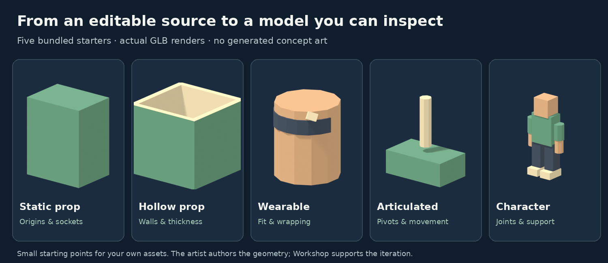
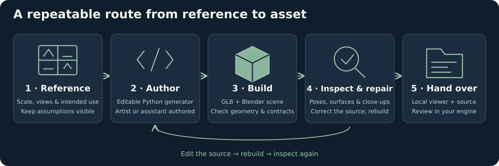
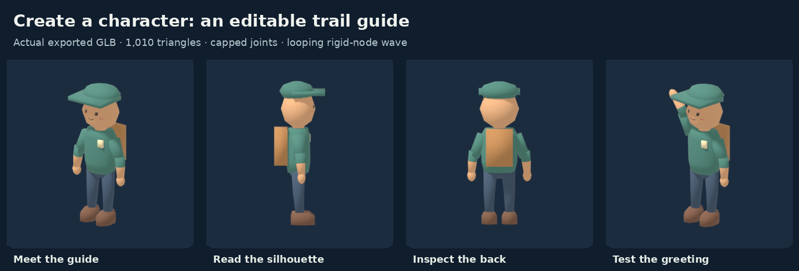
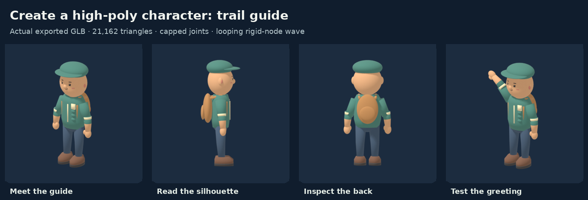
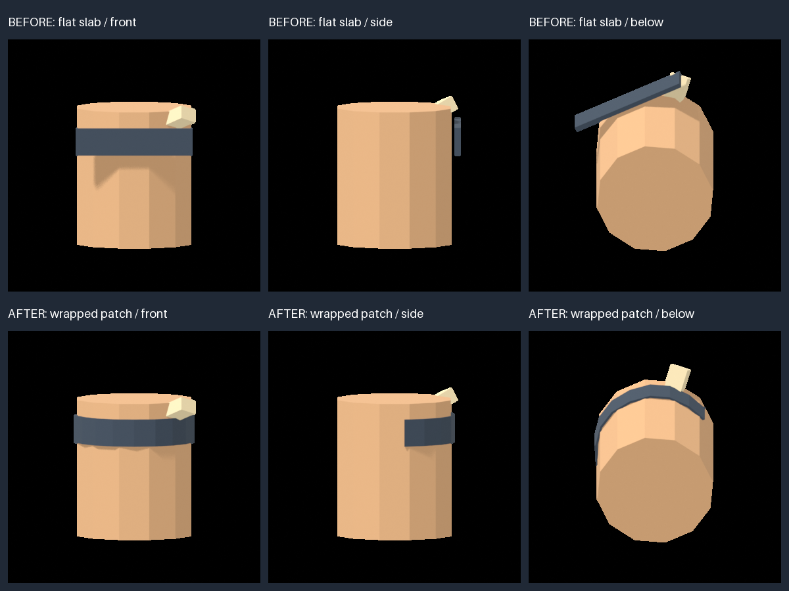

# Lowpoly Workshop

**Build, inspect and repair editable low-poly game assets.**

Turn your references and modelling decisions into a Python generator, a Blender project and a GLB you can inspect. Workshop supplies the geometry helpers, contract checks and review tools; you or your modelling assistant author the model.



**Open source · MIT · Python 3.10+ · Blender 4.5.** Current release: 0.3.0; main also includes [unreleased improvements](CHANGELOG.md). Modelling and local review need no account or image-generation service.

## How it works



1. **Define the asset.** Set scale, supplied views, intended use and export requirements. Record assumptions about hidden parts.
2. **Author an editable source.** Write `gen.py` with useful dimensions, materials, pivots and sockets, starting from a bundled example.
3. **Build and check.** Export GLB and `.blend` files; check geometry, budgets, masks, joints and declared contacts.
4. **Inspect and repair.** Review the actual export from different views and poses. Fix the source, rebuild and check again.
5. **Hand it over.** Package the model, sources and local review page. Check its appearance and movement in your target engine.

Workshop executes your generator; it does not reconstruct arbitrary images into meshes by itself. Optional image tools can suggest missing design views, with their provenance kept separate from supplied references.

## Create your first character

Go beyond the basic starter: build an original trail guide with rounded forms, a face, cap, backpack and a looping greeting. Edit its dimensions and colours, then inspect the exported joints and poses.



**[Follow the character walkthrough →](docs/create-character.md)** · Editable source included · No image-generation account needed

Want more detail? The **[high-poly character example](docs/create-character-high.md)** adds smooth forms, shaped ears/nose, straps, cuffs and boot details at about 21,000 triangles.



## See a repair

A mesh can be closed and still fit badly. Here a flat fringe is replaced with a surface-wrapped patch; front, side and underside views make the difference visible.



This is a reproducible procedural demonstration, not an automatic artistic score. [See the example, evidence and rebuild command →](docs/repair-demos.md)

## Try it

From a source checkout, with Python and Blender installed:

```sh
git clone https://github.com/dngames/Lowpoly-Workshop.git
cd Lowpoly-Workshop
python -m venv .venv
# Activate .venv, then:
python -m pip install .
lowpoly doctor
lowpoly new work/crate --kind static-prop --guided
lowpoly work/crate all
lowpoly serve work/crate/out/page --port 8000
```

Open **http://127.0.0.1:8000** to inspect the result. The viewer uses bundled Three.js locally. If Blender is not on PATH, set `KIT_BLENDER` to its executable. See the [setup guide](docs/quickstart.md) for Windows, local caches and the official `bpy` alternative.

## Choose a starting point

| Starter | What it demonstrates |
|---|---|
| `static-prop` | A solid object with a support origin and socket |
| `hollow-prop` | Inner walls, an open mouth and real thickness |
| `wearable` | A fitted patch that wraps around its host |
| `articulated` | Separate parts, pivots and motion |
| `character` | Connected limbs, support and pose checks |

These are small, editable teaching examples. Build your asset's silhouette, proportions and detail into the generator rather than treating the starters as finished artwork.

## What you get

- **Editable modelling:** parametric primitives, closed organic shapes, wrapped patches, cleanup helpers, rigid clips and optional skeletal export.
- **Configurable checks:** topology, triangle budgets, UVs, masks, pivots, contact, support and clearance at declared poses.
- **Visual iteration:** fitted reference comparisons, coverage suggestions, actual-export close-ups and textured/clay/checker/wireframe views.
- **Review and delivery:** optional feature checklists, decisions bound to current evidence, a local viewer and checksummed source/asset bundles.

Use it directly or give your modelling assistant the [Workshop skill](lowpoly_workshop/SKILL.md). Passing checks supports review; it cannot establish that an expression, silhouette, texture or animation looks right.

## Explore

| Start here | Go deeper |
|---|---|
| [Create a character](docs/create-character.md) | [Character example source](lowpoly_workshop/assets/examples/trail-guide) |
| [Quickstart](docs/quickstart.md) | [Generator and export contracts](docs/contracts.md) |
| [Guided review](docs/guided-review.md) | [Modelling and repair recipes](docs/modelling.md) |
| [Coverage and appearance](docs/appearance-workflow.md) | [Build validation](docs/build-validation.md) |
| [Reference views and providers](docs/references.md) | [Game adapters](docs/adapters.md) |
| [Review and release](docs/review-release.md) | [Legacy kit parity audit](docs/legacy-port-audit.md) |

[Roadmap](docs/roadmap.md) · [Testing](docs/testing.md) · [Validation record](VALIDATION.md) · [Licensing](docs/licensing.md) · [Contributing](CONTRIBUTING.md)

Workshop is an early release. We have not measured a speed, cost or quality advantage over a plain Blender agent or image-to-3D service; see the [comparison](docs/comparison.md) and [benchmark protocol](docs/benchmark.md).

The starter pictures and repair demonstration use original procedural examples. [Reproduce the README pictures](docs/readme-visuals.md); no consumer game artwork is included.
