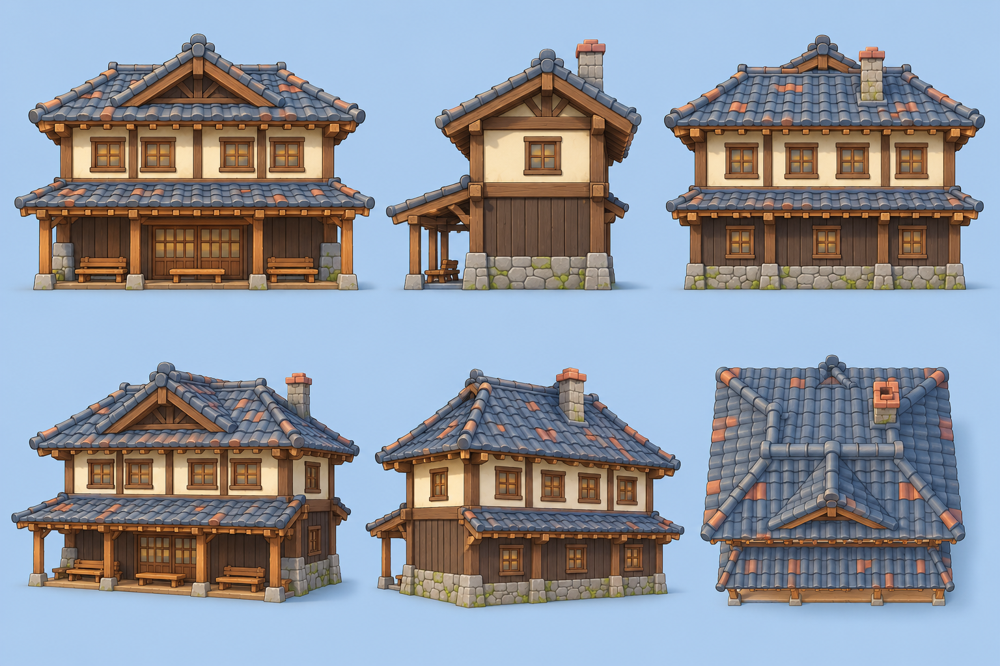
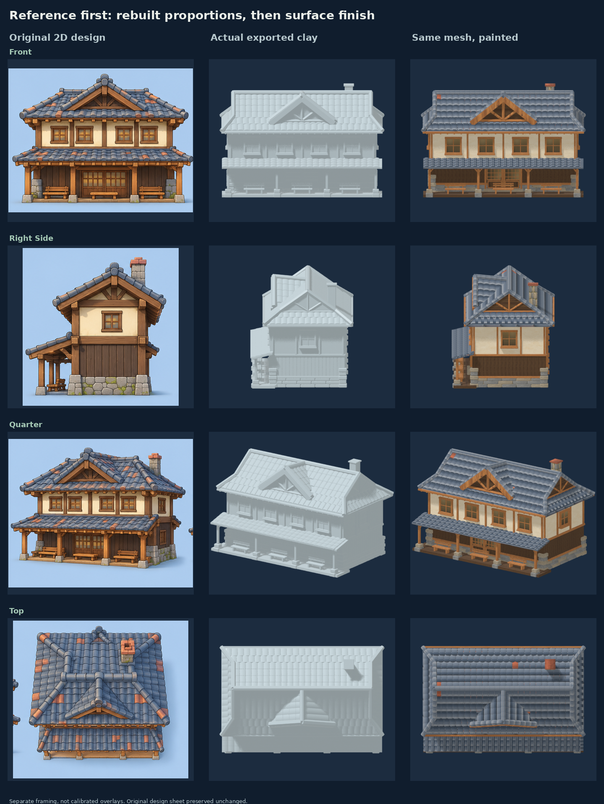
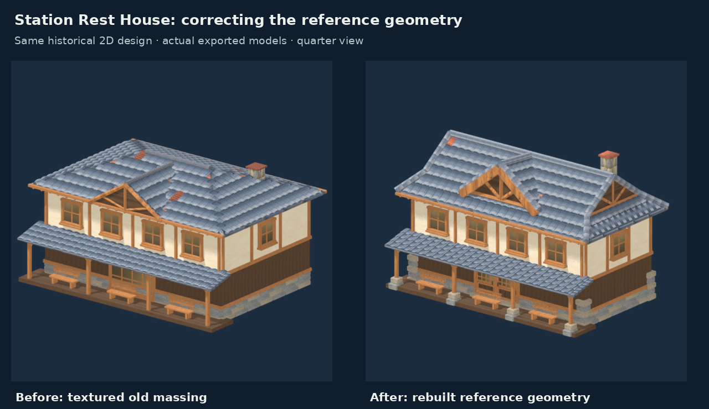
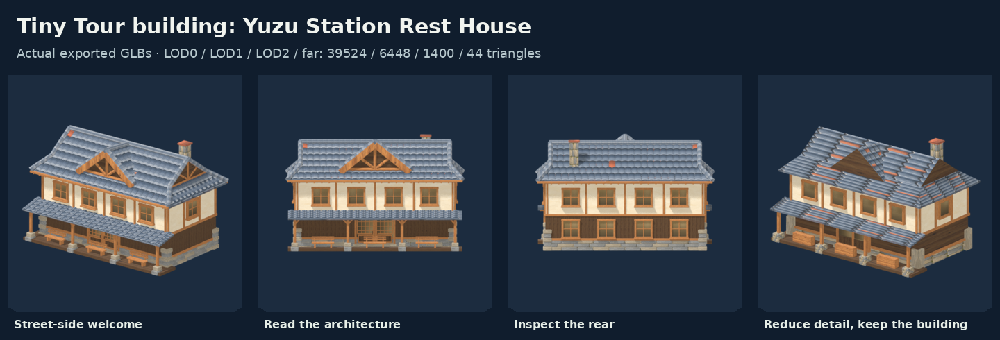
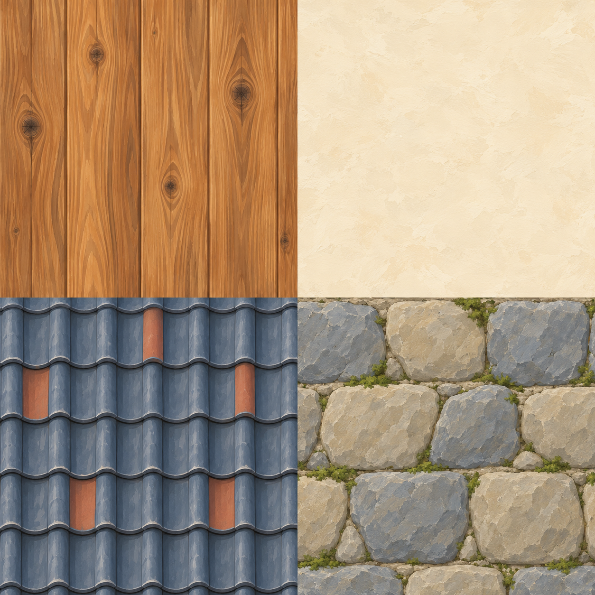
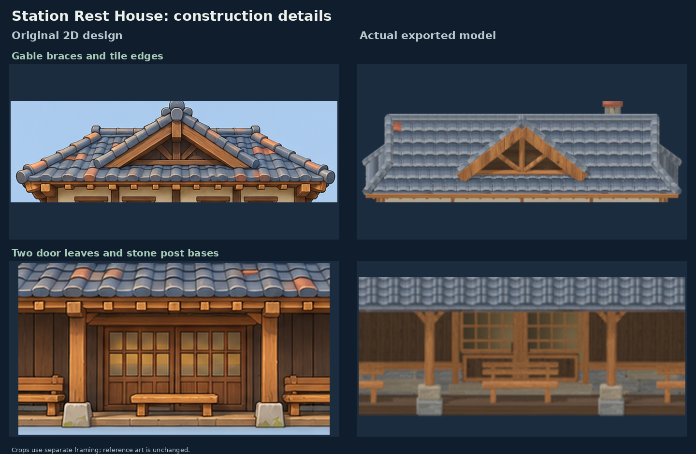

# Create a building: Tiny Tour's Station Rest House

Build an actual Tiny Tour asset with the standalone Workshop: the **Yuzu Station Rest House**, a two-storey building with a hipped roof, front gable, covered terrace, benches and framed windows.

## Start with the original 2D design



This historical AI-generated design sheet was the original modelling input. It is copied byte-for-byte from Tiny Tour; the original prompt is bundled beside it. “Original” means the design input, not a mesh render or a claim that the sheet was hand-drawn. The provider/model is not recorded here.

## Correct the massing before the materials

The first textured pass still retained the old body and roof interpretation. Owner feedback identified the excessive depth and wrong timber roof build-out. The geometry has now been rebuilt: the wall body is 7 m deep rather than 9 m; the main roof has timber gable ends above a lower hipped skirt; and the front feature is a closed timber front cross-gable embedded in the main roof slope.



These are separately framed comparisons, not fitted overlays. The original design art is unchanged. Manual shape notes are bundled in `inputs/reference-shape-notes.json`. Check the plain geometry before judging surface finish.

## Remodel: build the construction and materials



The comparison above uses the previous **textured** model as the baseline. Both sides use the same material artwork; the changed body depth, roof pitch, actual timber end gables and rebuilt front projection are geometric corrections.



This is a first-party Tiny Tour example included at the repository owner's request under Workshop's MIT license. The source's `provenance.json` identifies the Tiny Tour commit and file hashes, plus the small portability changes. The original sheet and prompt are included; game textures, fitted cameras and runtime placement code are excluded. The sheet is registered in `asset.json`, copied into new example projects and displayed in their review viewer. These pictures are rendered from the Workshop export, not captured from the game.

The corrected remodel uses a 14 × 7 m wall footprint and base-centred origin. Its tiled roof, framing, stonework, window depth and terrace braces now carry the character of the reference. It is still an authored stylized interpretation; the original sheet remains visible for comparison. Artistic acceptance is pending owner review.

## Build and open it

From a source checkout, with Workshop installed and Blender configured:

```sh
python scripts/building_example.py work/station-rest-house
lowpoly serve work/station-rest-house/out/page --port 8000
```

Open **http://127.0.0.1:8000**. Select a detail level and inspect front, side, back and quarter views. The helper creates an editable project, builds/checks all four GLBs, renders sixteen declared views plus six component diagnostics, then generates the local viewer and source bundle. Use an empty destination. Add `--source-only` to the first command to edit before building.

The source is bundled in `lowpoly_workshop/assets/examples/station-rest-house`; copying that folder into an empty project also works with the normal CLI.

## Understand the construction

The main wall footprint is **14 × 7 m**, with a roof about **9.7 m high** and a wider terrace/roof overhang. The pitched roof and ridge caps take the corrected model to about 9.81 m. The drawing’s silhouette, rather than the earlier 8 m brief envelope, governs this interpretation. Coordinates use metres, **+Y up**, **+Z toward the street**, and a base-centred origin.

Read the editable source in this order:

- `station_materials.py` builds a **2048 × 2048 painted atlas** from the new material sheet in `inputs/`. Cedar grain, cream plaster, ceramic and stone receive separate regions. The new artwork and its prompt are recorded independently of the historical building reference.
- `box()` adds optional bevel rings for timber frames and stones. Geometry gives those edges a silhouette; paint adds their surface character.
- `roof()` supplies a closed **irimoya** substrate: a continuous pitched front/back roof and actual timber end triangles above the lower hip skirt. `dormer()` builds the short closed front cross-gable, including its timber infill. `tile()` places separately closed, curved strips over the main roof, hips, front gable and terrace canopy. Segmented caps finish the main and gable ridges.
- Thin curved tile bands use **local outward directions** for face orientation. Their average point can lie outside the thin material volume, so a single guessed interior point can reverse underside faces even when the tile is closed. Source checks verify each primitive's directed edges and signed volume.
- Foundation courses use bevelled blocks with painted stone character. Ground-floor boards, upper-floor posts and belts establish the timber construction.
- Windows retain their established positions while adding frames, lintels, mullions, sills and warm painted glazing. The glazing is opaque; no interior or transparency is claimed.
- Four canopy posts, terrace brackets and slatted benches form the street-facing detail. Simpler levels preserve the principal architecture while reducing relief and joinery.

Edit geometry in `gen.py`, painted-region choices in `station_materials.py`, and budget metadata in `inputs/construction.json`. Changing its height field alone does not resize the geometry. Rebuild and inspect after changes.



The entrance has **two separate door leaves**, each with its own timber panel, glazed upper lattice and frame. Paired handles and a central join make the split readable. Projecting stone courses wrap the house corners and reach ground level. All four terrace posts stand on stone plinths that extend to ground and project in front of the wooden terrace, keeping their feet visible. Broad, flat timber bargeboards sit beneath the ceramic gable edges. The gable struts rise outward from beside the foot of the centre post to form `\|/`. Separate raised ceramic caps follow the verges, hips and ridge; tile noses are thicker than their field surfaces. The cap and accent materials sample a single ceramic tile rather than repeating the complete roof drawing on every cap. The curved main-roof tile rows continue across the exposed apron below the front gable: its exclusion must stop at the actual gable front, rather than extrapolating across the street-side roof. Keep these construction details visible in clay before judging their materials.



## Keep identity across detail levels

| Level | Triangles | Treatment |
|---|---:|---|
| LOD0 | 39,524 | Curved closed tile strips/caps, bevelled stone/timber, framed glazing, braces and slatted benches |
| LOD1 | 6,448 | Painted roof with segmented caps, masonry, framing and simplified joinery |
| LOD2 | 1,400 | Painted architectural masses, window surrounds, timber belts, terrace and bench proxies |
| Far | 44 | Roof and wall silhouette; furniture, openings and terrace omitted |

The old 685 / 517 / 201 / 28 triangle blockout is superseded by this remodel. The near-level budget is intentionally raised to 42,000; LOD1/2 budgets are 12,000 / 3,000. This is a hero building, so review actual use and performance before integration. The far proxy is deliberately sparse; it does not preserve every nearby feature. Workshop exports all four models but does not choose engine switching distances or wire them into Tiny Tour.

## Check, inspect and package

After editing:

```sh
lowpoly work/station-rest-house build
lowpoly work/station-rest-house check
lowpoly work/station-rest-house review
lowpoly work/station-rest-house page
lowpoly work/station-rest-house package
```

The checks verify export geometry, node names/pivots, budgets and UVs. Source checks verify each structural primitive is closed and outward-facing, plus support counts and architecture. Regressions also guard the 7 m body depth, actual timber gable faces and the hip tile height bound: sampling across the vertical end boundary must not stretch tiles over the wood. Hosts and attached details intentionally overlap; the whole assembly is not declared to be a single watertight solid. Regressions check facade positions across detail levels, post/canopy reach, bench seating, painted texture variation and closed/oriented tile relief.

Inspect roof intersections, facade depth, canopy supports and benches from multiple views. Successful checks are useful evidence, not artistic acceptance. Any engine import and LOD switching still need review in that engine.

## Prepare for Tiny Tour

The portable Workshop GLBs embed their painted atlas. Tiny Tour’s prop library replaces imported materials with its shared shaders, as it does for the Mirabelle Vale windmill. A direct atlas-file swap would lose the paint.

Tiny Tour uses a separate named-surface export with `COLOR_0`, physical UVs and the existing `wood`, `roofSlate`, `roofClay`, `stone`, `plaster` and `plain` names. The engine can then use its approved shared surface textures. This adapter lives in Tiny Tour, outside Workshop core. The integrated asset retains `yuzu-fifth-station-rest-house_LOD0/1/2` and `_far` names; the game asset is replaced in Yuzu’s existing rest-house slot when this correction is integrated, with the existing placement preserved.

## Reproduce the pictures

After building the project:

```sh
python scripts/building_visuals.py work/station-rest-house
```

This composes existing actual-export images into `docs/images/create-building.png`. Its evidence JSON records the Tiny Tour source commit, adapted source/spec hashes, checked status, triangle counts and model/image hashes.

For the before/after panel, rebuild the older example at Workshop commit `9fcd695` in a separate checkout, then run `python scripts/building_comparison.py OLD_PROJECT NEW_PROJECT`. Both sides are actual exported geometry; model, source and image hashes accompany the comparison.

The close-up reference comparison is generated with `python scripts/building_detail_comparison.py PROJECT`. The reference/clay/painted comparison is generated by `scripts/building_reference_comparison.py` after Blender runs `scripts/render_building_reference.py`. These views use the sheet’s right-side convention and preserve the historical input. They are not calibrated overlays.
