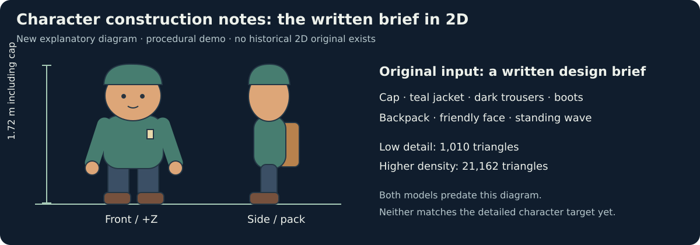

# Create a character: the trail guide

## Design input and provenance

This example began with a written brief and procedural code, **not an original 2D reference sheet**. The newly added diagram explains that brief; it was made after the model and is not evidence of reference matching.



## Exported result

Build an original, editable character with a readable face, cap, jacket, backpack and a greeting animation. This walkthrough starts from a written brief and procedural geometry, not a supplied drawing or an image-to-mesh service.


For a smoother companion with additional modelled details, see [Create a high-poly character](create-character-high.md).

## 1. Create the project

From a source checkout, with Workshop installed and Blender configured:

```sh
python scripts/character_example.py work/trail-guide
lowpoly serve work/trail-guide/out/page --port 8000
```

Open **http://127.0.0.1:8000**. The script creates an isolated project, builds/checks its GLB, renders its declared views and poses, then creates the local viewer and source bundle. The destination must be empty. No image service or original game artwork is used.

To create only the editable project before building:

```sh
python scripts/character_example.py work/trail-guide --source-only
```

The example source is bundled under `lowpoly_workshop/assets/examples/trail-guide`. You can also copy that folder into an empty workspace and use the normal `lowpoly` commands. The source checkout includes the convenience scripts; they are not required by an exported asset.

## 2. Establish the design and contract

The brief is deliberately small:

- A standing trail guide, about **1.72 m** tall, facing **+Z**, with **+Y** up and soles at **Y = 0**.
- Teal jacket/cap, dark trousers, brown boots/backpack and a simple friendly face.
- One rigid-part greeting: raise the right arm and wave without opening the shoulder or elbow.
- At most **3,000 triangles**, editable source, a GLB and Blender scene, and an inspectable local page.

The exported example uses 1,010 triangles. It demonstrates a standing gesture; it does not supply a walk controller, skinning or engine retargeting. The generic character starter and the separate `skin` hook remain available for those workflows.

## 3. Edit meaningful parameters

Open `work/trail-guide/gen.py`. The example exposes:

```python
p = {'height': 1.72, 'body_width': .46, 'pack_depth': .16}
```

Change these defaults to set the character's scale, jacket width and backpack depth. The generator scales geometry and pivots together to match the requested height while retaining ground contact. The declared ranges reject obviously unsuitable inputs; inspect any edited design and movement again.

Change palette cells in `ATLAS` to alter clothing colours. Jacket/cap use mask **R**, while the lining/badge use **G**. Skin, trousers, boots and backpack stay separate. The consuming engine decides how to use these data channels.

## 4. Build connected forms

Read `build(p)` in the example:

- **Rounded volumes:** small capped lofts form the head, jacket, hands and boots. All ring radii stay positive, avoiding repeated pole vertices.
- **Shoulders and elbows:** capped limb ends overlap at their actual pivots. Upper and lower arms are separate nodes; the forearm and hand belong together.
- **Face paint:** small eye, cheek and smile patches project onto the actual head surface. They live in a thin `FacePaint` child that follows `Head`; they are excluded from closed-solid declarations.
- **Attached details:** the backpack and badge overlap the jacket. Feet have flat bottoms, with ankle overlap inside the boots.

A closed hand or arm is not proof that it attaches correctly. The project therefore declares shoulder, elbow, hip, ankle and neck contacts, plus clearance between the waving forearm/hand and the head.

## 5. Check the exported character and gesture

After changing source:

```sh
lowpoly work/trail-guide build
lowpoly work/trail-guide check
lowpoly work/trail-guide review
lowpoly work/trail-guide page
```

The checker audits actual GLB nodes, pivots, geometry, budgets, masks and declared closed solids. Source relations run at rest, halfway raised and waving. The example's unit regression samples the greeting through its range, checking right-arm attachment and head clearance. This is finite sampling, not a proof for every possible pose or parameter combination.

`clips()` supplies a two-second looping **Greeting** clip. The exporter also preserves a **Stand** rest clip. In the local viewer, select the greeting and scrub it; inspect the front, side and back. Check the head, shoulder, elbow and feet rather than relying only on the attractive quarter view.

Review after each edit. A successful check supports your inspection; neither this example nor its pictures record automatic artistic acceptance.

## 6. Package and continue

```sh
lowpoly work/trail-guide package
```

The project contains `gen.py` and `asset.json`; `out/` contains `guide.glb`, its editable `.blend`, colour atlas, mask, check results, actual-export review images, local page and source bundle.

Try one change at a time: another jacket colour, a shorter character, a deeper backpack, or a different gesture within verified clearances. Rebuild and inspect the result. When taking the character into a game, verify its axes, scale, material/mask interpretation and animation through that engine's importer.

## Reproduce these pictures

Use a fresh empty destination below, or skip the first command if you already built that project.

```sh
python scripts/character_example.py work/trail-guide
python scripts/character_visuals.py work/trail-guide
```

The second command composes the existing actual-export renders into `docs/images/create-character.png`. The accompanying evidence JSON records source/spec, GLB and image hashes, checked status and the selected views. Keep the scratch project if you want to inspect the underlying review index. Rendering and font differences can change image bytes across platforms.
